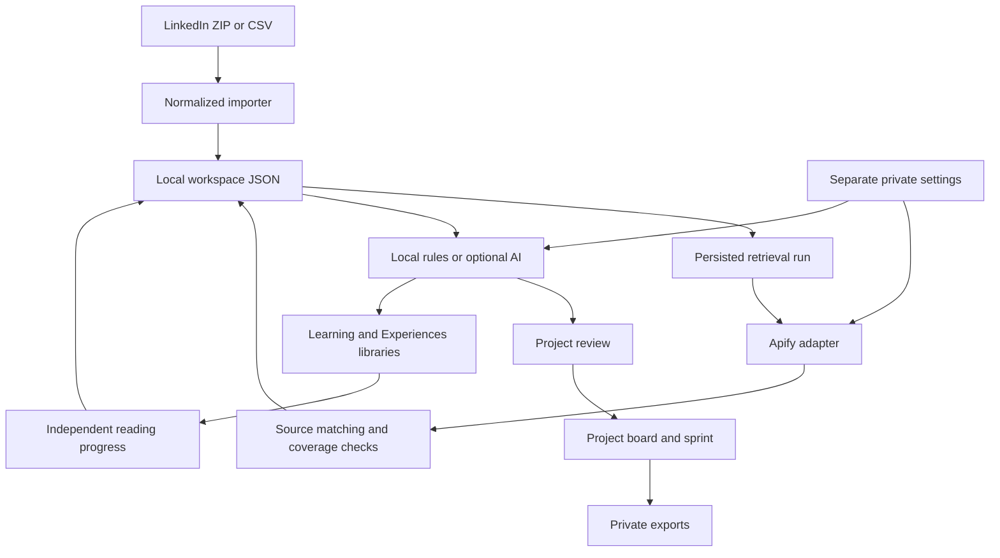

# Architecture

Saved to Shipped is a local, single-user Python application with a plain browser interface. Hosted providers recover content and optionally classify it. The Python runtime has no third-party dependencies.

## Package boundaries

| Module under `saved_to_shipped/` | Responsibility |
| --- | --- |
| `core.py` | Save identity, atomic JSON, merge, triage validation, CLI, scoring and output |
| `sources/` | Local import adapters and platform-neutral `ImportedSave` contract |
| `settings.py` | Data path resolution and private provider configuration |
| `enrichment.py` | Apify transport, persisted retrieval lifecycle, source matching, content cache and coverage |
| `classifier.py` | Optional structured OpenAI request and batch validation |
| `workbench.py` | Capture, groups, suggestions, task validation, independent reading state, and ZIP exports |
| `server.py` | Loopback transport, static allowlist, write token and provider orchestration |
| `web/` | Setup, import/retrieval guidance, polling, review and views |
| `demo_data.py` | Explicitly synthetic examples |

Root `server.py` and `saved_to_shipped.py` preserve earlier source commands. The package ships its own HTML/CSS/JS. Installed tests use isolated imports and a different working directory, so a missing wheel asset cannot be hidden by the checkout.

Shared CSS color tokens define light and dark palettes across every surface. A small synchronous `theme.js` applies the saved browser preference before the stylesheet loads, avoiding a light flash for a dark override. System mode listens for device appearance changes; explicit light/dark choices persist in local storage and synchronize between tabs. Theme changes update root attributes without redrawing editors. Provider settings and workspace exports remain independent of browser appearance preferences.

The browser has four primary destinations: Saves, Projects, Learning, and Experiences. Projects contains the build-only board, weekly planning, and completed build items. Learning includes `learning` and `reference`; Experiences includes `experience`. Existing group IDs serve as reading topics. Landing prefers Projects when build items exist, then Learning, Experiences, or Saves. Legacy `#projects` and `#backlog` links still open the project board.

Saves presents one contextual next action: resolve a pending run, review project drafts, classify readable content, or retrieve missing content. Project review keeps source context read-only and advances through drafts after approval/parking. A separate Notes editor changes personal context or pasted post text, submitting only changed fields. Provider options and less frequent editing controls use details disclosures.

`web/reading.js` renders the two reading libraries and the focused reader. Library filtering combines topic, reading state, text search, and estimated available time. Order is deterministic: unfinished reading, queued choices, then saved date. Suggestions use those same filters and exclude completed saves. Estimates count cached source words, falling back to personal notes, at 200 words per minute. Excerpts are escaped source text, not generated summaries. Coverage notices and source links remain attached.

Reading routes retain topic, status, length, search, and reader ID in the fragment. Opening a save starts reading; debounced scroll updates persist the furthest position, capped below explicit completion. The client serializes mutations per item and flushes pending progress before navigation. A reload restores an approximate position in the saved text. `Mark read` completes the read and clears its queue flag. Notes and metadata use separate editors; reading never changes task `status`.

Task review and reading organization share an assignment dropdown with inline section creation. Changing kind updates its project/topic/experience wording without redrawing the form. Selecting creation enables a name field; returning to an existing section excludes that draft name. `/api/item` accepts either `project_id` or `new_project_name` (nonblank, at most 100 characters). New names reuse case-insensitive matches. Creation, assignment, and the item edits validate in memory and save once, so a failed task check cannot leave an orphan group.

The board has Review, To do, In progress, and Done lanes. Pointer dragging uses a handle, movement threshold, pointer capture, drop indicator, and cancellation outside a lane or on Escape. A native Move select provides a keyboard/touch alternative. `/api/move` validates status and destination, then atomically saves the status and explicit `board_order`. Existing task-readiness checks apply to dragging as well. The client reconciles with the server after saving or an uncertain response; it does not resubmit automatically. Notes, source content, task fields, and provider provenance are preserved during moves.

## Persistent state

The version-1 workspace format remains compatible with earlier saves. Items retain stable IDs, URLs, saved dates, annotations, classifications, project assignments, and progress. New optional collections are initialized lazily.

- `projects`: stable group IDs, names, descriptions, creation times.
- `imports`: recent import summaries.
- `retrieval_jobs`: selected item IDs, provider/actor, run and dataset references, status, charge cap, counts, timestamps, and safe errors.
- Item `enrichment`: retrieval provenance, coverage, source links, status, and truncation information.
- Item `reading`: optional `{status, progress, queued, started_at?, completed_at?, updated_at}`. Status is `unread`, `reading`, or `read`; progress is 0 to 100. `/api/reading` validates the item kind and available context, then saves atomically under the HTTP mutation lock. Progress is monotonic until an explicit unread reset. A snapshot derives legacy doing/done as reading/read without rewriting the file. Explicit reading metadata takes precedence. Included in JSON backups.
- `goals`: optional personal direction used during triage.
- `board_order`: stable item IDs in the user's explicit tile order. Unranked items use score order until arranged. Included in workspace backups.

Provider credentials live in a separate `settings.json`. Exports serialize the workspace, never the settings file. Temporary-file replacement gives settings owner-only file permissions on supported systems. Environment variables override stored values; public configuration exposes only availability flags and nonsecret options.

## Retrieval lifecycle

1. Select eligible LinkedIn post/article links without existing post text. Completed and parked saves are skipped.
2. Persist a STARTING job before making one hosted submission. Default discovery outside selected sources is disabled.
3. Store the returned run ID immediately. Subsequent browser checks query that run rather than resubmitting input.
4. On a terminal run, page through its dataset and match returned URLs or activity IDs to the requested saves.
5. Merge verified text, author, document transcript when supplied, and safe external links. Existing user content and annotations win.
6. Record unavailable results explicitly. A stopped/failed run can still contribute results it already collected.

A network failure during submission may have created a paid run. Such submissions become UNCERTAIN and block another submission until explicitly dismissed after a console check. Poll/result errors keep the known run reference and can retry reading it. A separate poll lock prevents two tabs from applying the same dataset concurrently.

## Evidence rules

Only text or a nonblank personal note supports classification. URL slugs and titles alone are excluded. Provider login-wall text is rejected. Unrelated dataset rows are ignored and never assigned by output order. Coverage distinguishes recovered post text from document transcripts and partial media content. Text is capped at 20,000 characters with a visible flag.

The provider is trusted to return content for the reported source. A ten-post live dataset matched saved links, but fidelity against original pages and broader coverage still require validation. No code can infer inaccessible originals or guarantee that every document transcript is complete. See the [live check](docs/LIVE_CHECK.md).

## Concurrency and HTTP boundary

A process-local lock serializes workspace reads and mutations. Hosted retrieval network calls run outside that lock, then merge into current state. AI classification currently holds the HTTP mutation lock during its bounded request. Stop the server before editing its store from the separate CLI process.

The server binds IPv4 loopback, validates Host/port, requires a per-run token for POST requests, disables caching, forbids embedding, and allowlists static assets. ZIP uploads are capped at 128 MiB, Saved Items decompression at 8 MiB, and non-import JSON at 1 MiB. Archive paths are never extracted onto disk.

## Provider boundary

The initial retrieval adapter targets the documented `data_minds/linkedin-post-scraper` schema. Its actor ID can be overridden only with a compatible implementation. The transport uses authorization headers, bounded responses/timeouts, a run charge cap, and no automatic submission retries. Provider errors are redacted rather than echoing raw bodies or tokens.

The model client receives context-backed items, coverage, goals, and project names. It validates exact ID coverage and field types before saving drafts. Local suggestions remain explicitly heuristic. Neither classifier starts tasks or publishes issues automatically.
