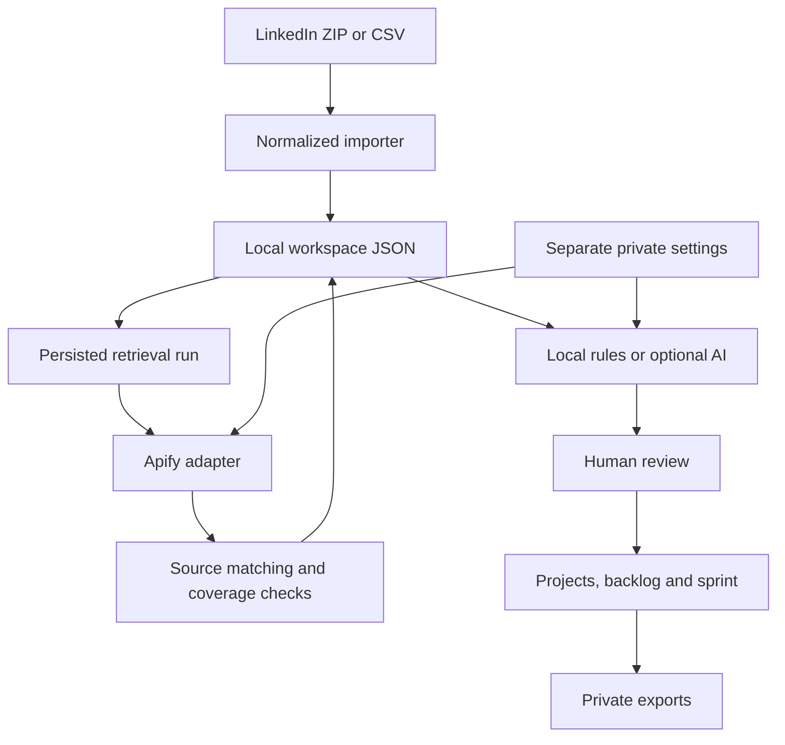

# Architecture

Saved to Shipped is a local, single-user Python application with a plain browser interface. Hosted providers recover content and optionally classify it. The Python runtime has no third-party dependencies.

## Package boundaries

| Module under `saved_to_shipped/` | Responsibility |
| --- | --- |
| `core.py` | Save identity, atomic JSON, merge, triage validation, CLI, scoring and output |
| `sources/` | Local import adapters and platform-neutral `ImportedSave` contract |
| `settings.py` | Data path resolution and private provider configuration |
| `enrichment.py` | Apify transport, persisted retrieval lifecycle, source matching, content cache and coverage |
| `classifier.py` | Optional structured OpenAI request and batch validation |
| `workbench.py` | Capture, groups, local suggestions, review rules and ZIP exports |
| `server.py` | Loopback transport, static allowlist, write token and provider orchestration |
| `web/` | Setup, import/retrieval guidance, polling, review and views |
| `demo_data.py` | Explicitly synthetic examples |

Root `server.py` and `saved_to_shipped.py` preserve earlier source commands. The package ships its own HTML/CSS/JS. Installed tests use isolated imports and a different working directory, so a missing wheel asset cannot be hidden by the checkout.

## Persistent state

The version-1 workspace format remains compatible with earlier saves. Items retain stable IDs, URLs, saved dates, annotations, classifications, project assignments, and progress. New optional collections are initialized lazily.

- `projects`: stable group IDs, names, descriptions, creation times.
- `imports`: recent import summaries.
- `retrieval_jobs`: selected item IDs, provider/actor, run and dataset references, status, charge cap, counts, timestamps, and safe errors.
- Item `enrichment`: retrieval provenance, coverage, source links, status, and truncation information.
- `goals`: optional personal direction used during triage.

Provider credentials live in a separate `settings.json`. Exports serialize the workspace, never the settings file. Temporary-file replacement gives settings owner-only file permissions on supported systems. Environment variables override stored values; public configuration exposes only availability flags and nonsecret options.

## Retrieval lifecycle

1. Select eligible LinkedIn post/article links without existing post text. Completed and parked saves are skipped.
2. Persist a STARTING job before making one hosted submission. Default discovery outside selected sources is disabled.
3. Store the returned run ID immediately. Subsequent browser checks query that run rather than resubmitting input.
4. On a terminal run, page through its dataset and match returned URLs or activity IDs to the requested saves.
5. Merge verified text, author, document transcript when supplied, and safe external links. Existing user content and annotations win.
6. Record unavailable results explicitly. A stopped/failed run can still contribute results it already collected.

A network failure during submission may have created a paid run. Such submissions become UNCERTAIN and block another submission until explicitly dismissed after a console check. Poll/result errors keep the known run reference and can retry reading it. A separate poll lock prevents two tabs from applying the same dataset concurrently.

## Evidence rules

Only text or a nonblank personal note supports classification. URL slugs and titles alone are excluded. Provider login-wall text is rejected. Unrelated dataset rows are ignored and never assigned by output order. Coverage distinguishes recovered post text from document transcripts and partial media content. Text is capped at 20,000 characters with a visible flag.

The provider is trusted to return content for the reported source; a live quality check is still required. No code can infer inaccessible originals or guarantee that every document transcript is complete.

## Concurrency and HTTP boundary

A process-local lock serializes workspace reads and mutations. Hosted retrieval network calls run outside that lock, then merge into current state. AI classification currently holds the HTTP mutation lock during its bounded request. Stop the server before editing its store from the separate CLI process.

The server binds IPv4 loopback, validates Host/port, requires a per-run token for POST requests, disables caching, forbids embedding, and allowlists static assets. ZIP uploads are capped at 128 MiB, Saved Items decompression at 8 MiB, and non-import JSON at 1 MiB. Archive paths are never extracted onto disk.

## Provider boundary

The initial retrieval adapter targets the documented `data_minds/linkedin-post-scraper` schema. Its actor ID can be overridden only with a compatible implementation. The transport uses authorization headers, bounded responses/timeouts, a run charge cap, and no automatic submission retries. Provider errors are redacted rather than echoing raw bodies or tokens.

The model client receives context-backed items, coverage, goals, and project names. It validates exact ID coverage and field types before saving drafts. Local suggestions remain explicitly heuristic. Neither classifier starts tasks or publishes issues automatically.
