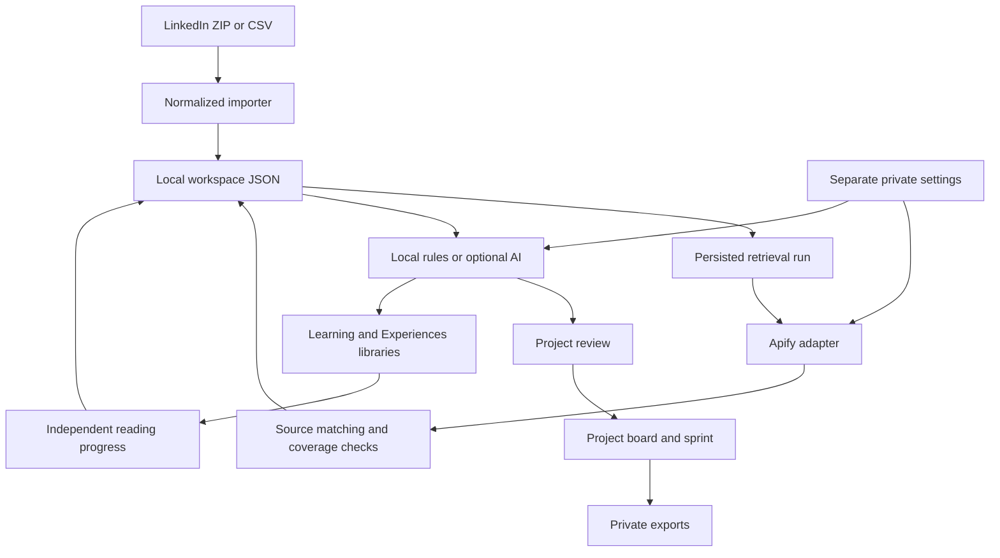

# Architecture

Saved to Shipped is a local, single-user Python application with a plain browser interface. Hosted providers recover content and optionally classify it. The Python runtime has no third-party dependencies.

## Package boundaries

| Module under `saved_to_shipped/` | Responsibility |
| --- | --- |
| `core.py` | Save identity, atomic JSON, merge, triage validation, CLI, scoring and output |
| `sources/` | Local import adapters and platform-neutral `ImportedSave` contract |
| `settings.py` | Data path resolution and private provider configuration |
| `enrichment.py` | Apify transport, persisted retrieval lifecycle, source matching, content cache and coverage |
| `classifier.py` | Optional structured OpenAI request and batch validation |
| `workbench.py` | Capture, groups, suggestions, task validation, independent reading state, and ZIP exports |
| `server.py` | Loopback transport, static allowlist, write token and provider orchestration |
| `web/` | Setup, import/retrieval guidance, polling, review and views |
| `demo_data.py` | Explicitly synthetic examples |

Root `server.py` and `saved_to_shipped.py` preserve earlier source commands. The package ships its own HTML/CSS/JS. Installed tests use isolated imports and a different working directory, so a missing wheel asset cannot be hidden by the checkout.

Shared CSS color tokens define light and dark palettes across every surface. A small synchronous `theme.js` applies the saved browser preference before the stylesheet loads, avoiding a light flash for a dark override. System mode listens for device appearance changes; explicit light/dark choices persist in local storage and synchronize between tabs. Theme changes update root attributes without redrawing editors. Provider settings and workspace exports remain independent of browser appearance preferences.

The browser has four primary destinations: Saves, Projects, Learning, and Experiences. Projects contains the build-only board, weekly planning, and completed build items. Learning includes `learning` and `reference`; Experiences includes `experience`. Existing group IDs serve as reading topics. Landing prefers Projects when build items exist, then Learning, Experiences, or Saves. Legacy `#projects` and `#backlog` links still open the project board.

Saves presents one contextual next action: resolve a pending run, review project drafts, classify readable content, or retrieve missing content. Project review keeps source context read-only and advances through drafts after approval/parking. A separate Notes editor changes personal context or pasted post text, submitting only changed fields. Provider options and less frequent editing controls use details disclosures.

`web/reading.js` renders the two reading libraries and the focused reader. Library filtering combines topic, reading state, text search, and estimated available time. Order is deterministic: unfinished reading, queued choices, then saved date. Suggestions use those same filters and exclude completed saves. Estimates count cached source words, falling back to personal notes, at 200 words per minute. Excerpts are escaped source text, not generated summaries. Coverage notices and source links remain attached.

Reading routes retain topic, status, length, search, and reader ID in the fragment. Opening a save starts reading; debounced scroll updates persist the furthest position, capped below explicit completion. The client serializes mutations per item and flushes pending progress before navigation. A reload restores an approximate position in the saved text. `Mark read` completes the read and clears its queue flag. Notes and metadata use separate editors; reading never changes task `status`.

Task review and reading organization share an assignment dropdown with inline section creation. Changing kind updates its project/topic/experience wording without redrawing the form. Selecting creation enables a name field; returning to an existing section excludes that draft name. `/api/item` accepts either `project_id` or `new_project_name` (nonblank, at most 100 characters). New names reuse case-insensitive matches. Creation, assignment, and the item edits validate in memory and save once, so a failed task check cannot leave an orphan group.

The board has Review, To do, In progress, and Done lanes. Pointer dragging uses a handle, movement threshold, pointer capture, drop indicator, and cancellation outside a lane or on Escape. A native Move select provides a keyboard/touch alternative. `/api/move` validates status and destination, then atomically saves the status and explicit `board_order`. Existing task-readiness checks apply to dragging as well. The client reconciles with the server after saving or an uncertain response; it does not resubmit automatically. Notes, source content, task fields, and provider provenance are preserved during moves.

## Persistent state

The version-1 workspace format remains compatible with earlier saves. Items retain stable IDs, URLs, saved dates, annotations, classifications, project assignments, and progress. New optional collections are initialized lazily.

- `projects`: stable group IDs, names, descriptions, creation times.
- `imports`: recent import summaries.
- `retrieval_jobs`: selected item IDs, provider/actor, run and dataset references, status, charge cap, counts, timestamps, and safe errors.
- Item `enrichment`: retrieval provenance, coverage, source links, status, and truncation information.
- Item `reading`: optional `{status, progress, queued, started_at?, completed_at?, updated_at}`. Status is `unread`, `reading`, or `read`; progress is 0 to 100. `/api/reading` validates the item kind and available context, then saves atomically under the HTTP mutation lock. Progress is monotonic until an explicit unread reset. A snapshot derives legacy doing/done as reading/read without rewriting the file. Explicit reading metadata takes precedence. Included in JSON backups.
- `goals`: optional personal direction used during triage.
- `board_order`: stable item IDs in the user's explicit tile order. Unranked items use score order until arranged. Included in workspace backups.

Provider credentials live in a separate `settings.json`. Exports serialize the workspace, never the settings file. Temporary-file replacement gives settings owner-only file permissions on supported systems. Environment variables override stored values; public configuration exposes only availability flags and nonsecret options.

## Retrieval lifecycle

1. Select eligible LinkedIn post/article links without existing post text. Completed and parked saves are skipped.
2. Persist a STARTING job before making one hosted submission. Default discovery outside selected sources is disabled.
3. Store the returned run ID immediately. Subsequent browser checks query that run rather than resubmitting input.
4. On a terminal run, page through its dataset and match returned URLs or activity IDs to the requested saves.
5. Merge verified text, author, document transcript when supplied, and safe external links. Existing user content and annotations win.
6. Record unavailable results explicitly. A stopped/failed run can still contribute results it already collected.

A network failure during submission may have created a paid run. Such submissions become UNCERTAIN and block another submission until explicitly dismissed after a console check. Poll/result errors keep the known run reference and can retry reading it. A separate poll lock prevents two tabs from applying the same dataset concurrently.

## Evidence rules

Only text or a nonblank personal note supports classification. URL slugs and titles alone are excluded. Provider login-wall text is rejected. Unrelated dataset rows are ignored and never assigned by output order. Coverage distinguishes recovered post text from document transcripts and partial media content. Text is capped at 20,000 characters with a visible flag.

The provider is trusted to return content for the reported source. A ten-post live dataset matched saved links, but fidelity against original pages and broader coverage still require validation. No code can infer inaccessible originals or guarantee that every document transcript is complete. See the [live check](docs/LIVE_CHECK.md).

## Concurrency and HTTP boundary

A process-local lock serializes workspace reads and mutations. Hosted retrieval network calls run outside that lock, then merge into current state. AI classification currently holds the HTTP mutation lock during its bounded request. Stop the server before editing its store from the separate CLI process.

The server binds IPv4 loopback, validates Host/port, requires a per-run token for POST requests, disables caching, forbids embedding, and allowlists static assets. ZIP uploads are capped at 128 MiB, Saved Items decompression at 8 MiB, and non-import JSON at 1 MiB. Archive paths are never extracted onto disk.

## Provider boundary

The initial retrieval adapter targets the documented `data_minds/linkedin-post-scraper` schema. Its actor ID can be overridden only with a compatible implementation. The transport uses authorization headers, bounded responses/timeouts, a run charge cap, and no automatic submission retries. Provider errors are redacted rather than echoing raw bodies or tokens.

The model client receives context-backed items, coverage, goals, and project names. It validates exact ID coverage and field types before saving drafts. Local suggestions remain explicitly heuristic. Neither classifier starts tasks or publishes issues automatically.

## Preserved runtime experiment

The Git checkout also contains a separate TypeScript experiment under `hosted/`. It uses Cloudflare Workers and a SQLite-backed Durable Object to measure storage, full-text search and transaction behavior with synthetic libraries. Its public data API is closed. The local test harness is a separate entrypoint and is never part of the deployable Worker.

This experiment does not change the Python application's storage or introduce accounts into local use. Hosted dependencies, generated files and deployment configuration are excluded from the Python distribution. The [P1 evidence](docs/evidence/P1.md) records measured behavior and outstanding cloud checks. The production workbench below uses a separate schema and entrypoint.

## Closed hosted workbench

The TypeScript implementation is now present under `hosted/`, with a separate deployment template `wrangler.app.jsonc`. It is disabled by default, has a zero-member cap and empty admission/operator allowlists, and has not been deployed. The synthetic entrypoints exercise real Worker/SQLite behavior with generated identities and mocked providers. They are excluded from production artifacts. The Python distribution includes none of the hosted dependencies.

| Component | Responsibility |
| --- | --- |
| `client/bootstrap.mjs`, `firebase-auth.mjs`, `mfa-ui.mjs` | Google and verified Email/password sign-in, mandatory TOTP for password sessions, local enrollment QR, managed persistence, verification/reset and provider-aware reauthentication |
| `client/transport.mjs` | Memory-only workspace capability, paged metadata, on-demand details, revisioned writes and account-change cancellation |
| `client/archive.mjs`, `import-worker.mjs` | Bounded ZIP/CSV parsing in the browser, chunked restore and v1 backup assembly |
| `src/app.ts` | Verified identity, strict origin/body limits, API routing and operator boundaries |
| `src/auth/session.ts` | Cached Google certificates, signed 15-minute workspace capabilities and fresh account-status checks |
| `src/firestore/client.ts`, `registry.ts` | Trusted Firestore transport, atomic seats, stable generations, lifecycle epochs, allowlists and daily work reservations |
| `src/firestore/workspace.ts` | Authoritative row commits, checkpoint fencing, disposable-cache recovery, durable wake intents and paged purge |
| `src/storage/workspace.ts` | Shared transaction/domain engine, revisions, byte/item limits, import receipts and source-preserving merges; SQLite is a cache in Firestore mode |
| `src/jobs/orchestrator.ts` | Durable submission, bounded reconciliation, saved classification results and uncertainty handling |
| `src/providers`, `src/credentials` | Bounded BYOK adapters and versioned AES-GCM credential encryption |

Normal requests verify both the Firebase ID token and a capability bound to UID/generation, then route to that private workspace. Ordinary reads avoid the global registry and validate the Firestore checkpoint before using the local projection. The workspace checks ownership and lifecycle on every operation. Administrative suspension uses monotonic lifecycle epochs so delayed messages cannot revive a newer suspension. Firebase revocation is checked on capability renewal, with a maximum 15-minute window for ordinary requests; privileged routes check current account status directly.

Firestore Enterprise Native holds private workspace records, encrypted credentials, jobs, receipts, membership and budgets. A dedicated database-scoped IAM identity writes from the trusted API; deployed Security Rules deny all direct client reads and writes. Row changes and a unique checkpoint commit ID are committed atomically. A local pending marker prevents failed or unconfirmed SQL changes from becoming authoritative, and a cache can be rebuilt from consistent Firestore records. Core operations support these atomic transitions and bounded maintenance; browser search stays in the revalidated projection. See [Firebase setup](docs/FIREBASE_SETUP.md) for schema, recovery and deployment boundaries.

The browser retains metadata pages and hydrates source text/notes only when needed. An item-library revision detects changes from another browser without invalidating pages for job bookkeeping. Pages are staged atomically; returning to a tab refreshes the library when no editor is open. Hosted search scans at most 1,000 bounded saved bodies for full text, notes and metadata, returning matching IDs without adding a persistent search index. Search is debounced and keeps the same results before and after detail hydration. Signed-out or switched accounts lose cached data, requests, drafts and timers. Stale revisions preserve a user's unsaved draft rather than overwriting another browser's changes. Import parses only Saved Items, then sends at most 25 rows per request. An explicit new import uses a new operation ID; retries retain its ID and sequence. Source deduplication preserves edits when a file is selected again. Exports use authenticated paged reads and assemble JSON/CSV ZIPs locally; a changed workspace invalidates an in-progress export rather than mixing revisions.

A provider job reserves logical storage and a modeled completion allowance before QUEUED is persisted. A durable alarm claims STARTING once in Firestore, then submits outside the storage commit. Unknown outcomes remain UNCERTAIN. Known runs use leases and bounded claims; classification results are persisted before application. A bounded scheduled scan repairs lost alarm state from authoritative wake intents. Resuming a retrieval always checks provider status before declaring its dataset final. Content edits and save incarnations protect against stale enrichment, while notes do not block a fuller result from the same run.

Account deletion freezes local mutations atomically with job submission claims. It refuses uncertain submissions, aborts known runs, drops workspace data and credentials, then releases the seat. If an expired provider key prevents abort, the frozen account exposes only a fresh-authenticated deletion retry with optional encrypted key repair. Late callbacks and old capabilities cannot recreate a closed workspace.

Limits apply to canonical item JSON plus persisted operational JSON: 1,000 saves, 5,000,000 logical bytes, 131,072 bytes per item and bounded groups/jobs/receipts. A provisional 7,000,000-byte SQL used-page check does not certify the 8 MB physical allocation target. Daily modeled pools reserve ingestion, interactive, completion and cleanup work; failed attempts and retries count. These are implementation protections, not measured Cloudflare capacity. The [production plan](docs/PRODUCTION_PLAN.md), [backend evidence](docs/evidence/P3-P5.md) and [operations guide](docs/HOSTED_OPERATIONS.md) own the remaining live/deployed gates.

Deletion freezes the workspace before stopping known provider work. Only an explicitly authorized close starts the bounded Firestore purge; the frozen state alone cannot delete a provider job or its credential. After the remote purge, `deleteAll()` removes SQL, KV and alarms. Terminal generation records remain in Firestore. New provisioning includes the matching Registry reservation in the same atomic commit fence. A purge followed by interrupted Registry finalization can finish on a later authenticated deletion retry. Production uses separate Firebase Durable Object namespaces and rejects switching an existing projection back to SQL mode.

Firestore's 1 GiB Spark allowance replaces the former SQL-only storage envelope. The previous 500-member allocation and SQL capacity results do not certify this backend. Keep public admission closed until Firestore units/bytes, the additional cache and retained tombstones have been measured. The local Python workflow and its dependency boundary are unchanged.
