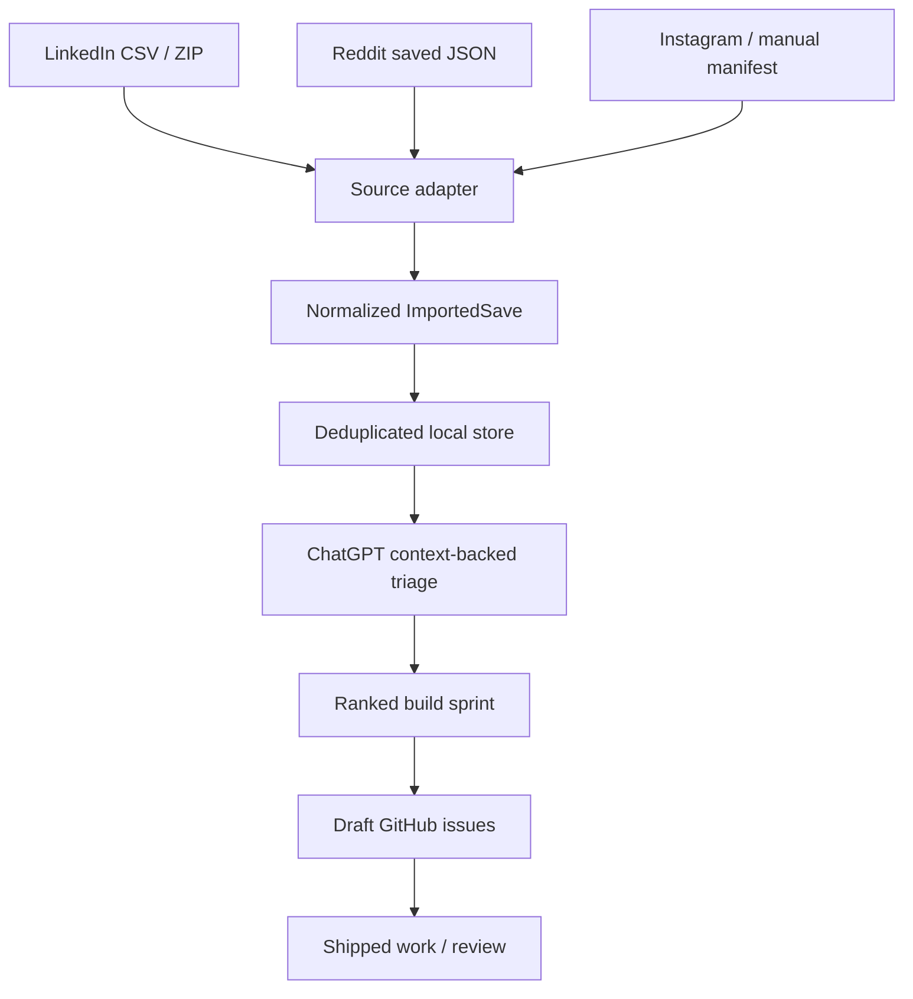

# Architecture — Saved → Shipped

## Design principle

**Ingestion is replaceable. Your action queue is not.** A source should be able to disappear, change its API, or require a different export without breaking the user-facing workflow.



## Current modules

| Module | Responsibility |
| --- | --- |
| `sources/base.py` | `ImportedSave` data contract, CSV helpers |
| `sources/linkedin.py` | Official Saved Items CSV and ZIP parsing |
| `sources/reddit.py` | Saved posts/comments from user-provided OAuth Listing JSON |
| `sources/manifest.py` | Normalized CSV/JSON for Instagram and future sources |
| `sources/registry.py` | Select an importer by explicit adapter name |
| `saved_to_shipped.py` | Stable IDs, merge, local JSON persistence, triage prompt, scoring, sprint, issue draft CLI |
| `tests/` | Regression tests for imports, migrations, scoring outputs and no-context safeguard |

## Normalized contract

```python
@dataclass(frozen=True)
class ImportedSave:
    platform: str
    url: str
    saved_at: str = ""
    external_id: str = ""
    title: str = ""
    content: str = ""
    author: str = ""
    metadata: dict = field(default_factory=dict)
```

Local state adds the triage and workflow fields: `id`, `note`, `kind`, `status`, scores, `next_action`, `definition_of_done`, and optional GitHub suggestions. The adapter does not decide priority or generate commits.

## Data integrity rules

1. IDs are stable from the platform and normalized URL. Historic LinkedIn IDs retain their old format to avoid breaking existing local state.
2. Importing the same archive twice is safe. New blank source fields can be filled from a later export, but existing user annotations and triage are not overwritten.
3. A source's *publication time* must never be labeled as the user's *saved time*. Reddit's `created_utc` is retained separately in metadata.
4. URL-only saves remain untriaged until a useful note or post text has been supplied. The tool rejects unsupported AI classifications.
5. No adapter calls network APIs, reads browser cookies or stores login credentials. Future OAuth sources must be opt-in, request minimal scopes, and avoid putting tokens into user-state or Git.
6. `data/` and `output/` are ignored by Git. The public code repository should never include a user's raw archives, copied posts or personal notes.

## Future boundaries

As the product expands, split the monolithic CLI into separate `domain`, `storage`, `ranking`, `enrichment`, `github`, and `interface` packages **when a real second implementation warrants it**. Keep the adapter contract stable throughout.

Potential components:

- **Capture pipeline:** official exports; share-to-app capture; optional provider OAuth when authorized and feasible.
- **Enrichment:** OCR for user-uploaded screenshots; public URL metadata with provenance; semantic duplicate clustering.
- **Decision engine:** personal interest graph; evidence-based scoring; what-to-do-now menus by available time.
- **Execution:** create GitHub issues after approval, generate branch-ready specs/tests, link actual PRs and commits.
- **Feedback loop:** personal completion rate, stale-save retirement, and weekly review.

## Why the import-first design

LinkedIn exports saved dates and URLs, but not complete third-party post text. LinkedIn disallows scraping/browser-extension capture of its site. Reddit documents its saved listing through an authenticated API, but access is governed by approvals and policies; its Devvit environment doesn't expose private saved data. Instagram's official saved-collection export shape still needs testing. Import adapters let the product work within each platform's actual access constraints.

## Testing and CI

```bash
python3 -m unittest discover -s tests -v
```

GitHub Actions runs the same test suite on push and pull requests. No API tokens or third-party accounts are needed for CI.
