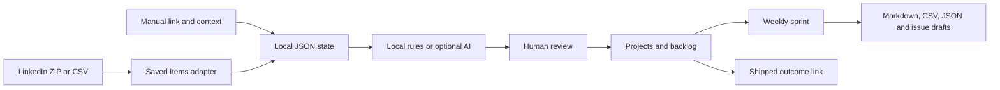

# Architecture

A single-user workbench running on the user's computer. Python serves static assets and a small HTTP API; the browser handles navigation and forms. There is no build step or third-party runtime dependency.

## Modules

| File | Responsibility |
| --- | --- |
| `sources/linkedin.py` | Find exactly one Saved Items CSV, bound decompression, validate rows, normalize source records |
| `sources/base.py` | Platform-neutral `ImportedSave` contract and CSV decoding |
| `saved_to_shipped.py` | Stable save IDs, dedupe, atomic state persistence, triage validation, scoring, sprint and issue draft CLI |
| `workbench.py` | Context-aware local suggestions, project groups, review rules, capture, import history, download bundles |
| `classifier.py` | Optional OpenAI Responses API request and complete-batch validation |
| `server.py` | Loopback HTTP transport, isolated stores, upload bounds, static asset allowlist and write token |
| `web/` | Responsive interface, native dialogs, filters, search and client-side views |
| `demo_data.py` | Explicitly synthetic examples, with no claim to real post content |
| `tests/` | Import, domain, mocked provider, and loopback HTTP regression tests |

## Durable data

`data/items.json` contains `version: 1`, `items`, `projects`, and recent `imports`. The existing item format remains compatible with the CLI. New top-level collections are initialized lazily, so old state does not need a destructive migration.

Each item carries a platform, canonical URL, stable ID, saved date, supplied text/note, classification, confidence, optional classification method, tags, action, finish condition, estimate, project ID, workflow status, and optional outcome link. User annotations and project assignments survive source re-import.

Each project has a stable ID, name, description, and creation timestamp. Multiple saves can belong to one project. Classification may suggest groups; the user can reassign individual saves. A project group is distinct from an item's `kind=project`, which means a build task rather than a learning, experience, reference, or skip item.

`data/demo/items.json` is a separate workspace. The server seeds it only when absent. It never seeds the personal store. A workspace query parameter selects one of these two known paths; the client cannot supply an arbitrary filesystem path.

## Invariants

1. URL or title alone is insufficient evidence for classification. Only supplied post text or a nonblank personal note qualifies.
2. Import merges by stable platform-and-URL ID and fills blank source fields without replacing reviewed data.
3. Web classification produces inbox drafts. A ready/in-progress/shipped task requires context, classification, title, first action, done condition, and an estimate of 0.25 to 2 hours.
4. The full triage batch is validated before mutation. Unknown/duplicate IDs, invalid types, nonfinite numbers, missing actions, and unsupported classifications fail without saving.
5. Local classification is a keyword heuristic, labeled low confidence. Its broad themes and generic actions are starter suggestions, not semantic understanding.
6. AI requests include at most 20 unclassified, context-backed inbox items and require exact returned ID coverage. The raw archive and other account records are never sent.
7. Source adapters never fetch post bodies. An unavailable, private, or deleted post stays a link until the user supplies context.
8. Exports create local files only. No external issues, commits, or social posts are created.

## Persistence and concurrency

Writes use a temporary file in the state directory followed by atomic replacement. A process-local reentrant lock serializes HTTP reads and mutations, including classification, so concurrent browser requests cannot overwrite each other mid-update. AI requests have a 60-second timeout; requests for state can wait behind an active classification. That tradeoff is acceptable for this single-user app.

The CLI runs in a separate process and does not share that lock. Stop the web server before mutating state from the CLI or restoring a backup. Multi-user writes, background jobs, SQLite migrations, and hosted synchronization are deliberately outside the current scope.

## Local HTTP boundary

The server binds only to IPv4 loopback. It accepts only the printed localhost/127.0.0.1 Host and port. Writes require an unpredictable token returned to same-origin page requests. Responses disable caching, forbid embedding, omit referrers, and constrain scripts/connections to the same origin. Static files are allowlisted; the repository and state files cannot be browsed as files.

ZIP uploads are capped at 128 MiB; Saved Items decompression at 8 MiB. Archive entries are read in memory without extracting paths to disk. Non-import JSON requests are capped at 1 MiB. Uploaded temporary files are cleaned after processing. Keys stay in process environment variables and are never returned in state responses.

These boundaries suit a personal local app. They are not a replacement for authentication, TLS, and a production server if the deployment scope changes.

## Extension points

The inherited `ImportedSave` contract preserves future Reddit/Instagram adapters without changing review, scoring, or export logic. Existing adapters remain available through the CLI. Add native export formats only after obtaining a representative permitted fixture and regression tests. Real LinkedIn archive import is verified; the next validation is useful classification and review of a batch with supplied context.
