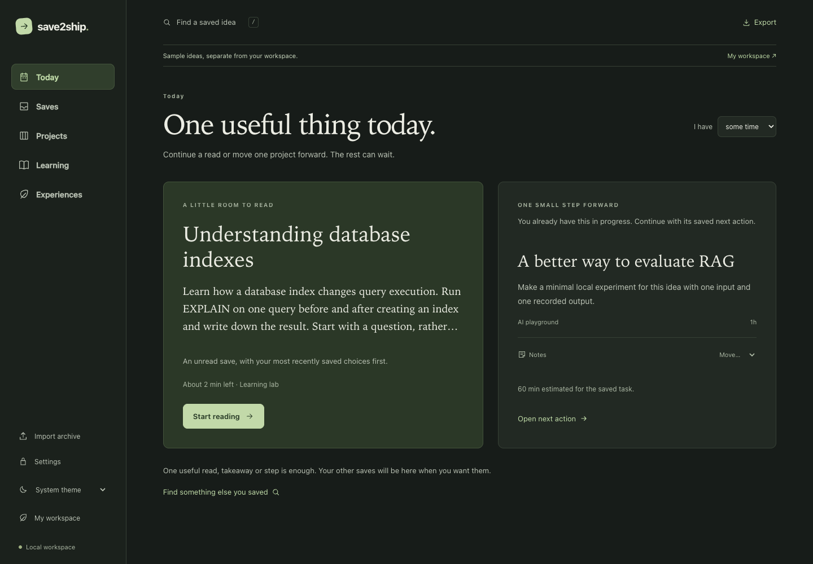

# Saved to Shipped

This is the `payment` development branch. The current runtime is still the free app; see [payment development](docs/PAYMENT_DEVELOPMENT.md) for the preserved prototype and next steps. Use [`main`](https://github.com/the-anantkumar/saved-to-shipped/tree/main) for the OSS release.

**A little less saving. A little more doing.**

[](https://github.com/the-anantkumar/saved-to-shipped/releases/tag/v0.4.0b1)
[](https://github.com/the-anantkumar/saved-to-shipped/actions/workflows/tests.yml)
[](pyproject.toml)
[](LICENSE)

Saved to Shipped turns your LinkedIn saved archive into things you can read, learn from and build. Import once, choose a few useful ideas, and return to one clear next step.

[Download v0.4.0b1](https://github.com/the-anantkumar/saved-to-shipped/releases/tag/v0.4.0b1) or run it from source below.



*Real interface with synthetic sample content. [Mobile view](docs/assets/workspace-mobile.png).*

## Start locally

With **Python 3.10+** installed:

```sh
git clone https://github.com/the-anantkumar/saved-to-shipped.git
cd saved-to-shipped
python3 server.py
```

Open [127.0.0.1:8010](http://127.0.0.1:8010/). No runtime dependencies, frontend build, database or application account is needed.

Try the [separate sample workspace](http://127.0.0.1:8010/?workspace=demo) first. It contains synthetic examples and needs no API keys. Stop the server with `Ctrl+C`.

<details>
<summary>Prefer an installed command?</summary>

From the checkout, create a virtual environment and install:

```sh
python3 -m venv .venv
source .venv/bin/activate  # Windows: .venv\Scripts\activate
python -m pip install .
saved-to-shipped
```

`python -m saved_to_shipped` also launches the app. To install the published wheel instead, download it from [v0.4.0b1](https://github.com/the-anantkumar/saved-to-shipped/releases/tag/v0.4.0b1), then run `python -m pip install ./saved_to_shipped-0.4.0b1-py3-none-any.whl` in your environment.

</details>

## Start with five saves

1. Import your official LinkedIn Saved Items ZIP or CSV.
2. Choose five links relevant to something you care about now. Leave the rest dormant.
3. Paste source text, or explicitly retrieve the selected posts using your own extractor key and charge cap.
4. Organize them into **Projects**, **Learning** or **Experiences**. Local rules need no key; AI suggestions are optional.
5. Finish one read, takeaway or project step. Export, then return through **Today** tomorrow.

Re-imports preserve your notes, organization and progress. Source text and personal notes stay separate. [Full usage guide](docs/USAGE.md).

## A home for each intention

| Space | Use it for |
| --- | --- |
| **Today** | Continue an unfinished read or an active build step. |
| **Projects** | Review a small next action, move work through the board, and attach a result. |
| **Learning** | Browse topics, filter by reading time, resume your place and keep takeaways. |
| **Experiences** | Revisit stories, lessons and opportunities in a separate reading library. |

Global search includes your notes. Dark mode, narrow layouts and keyboard controls work across the interface. Reading progress stays independent of project stages.

## Free to run, with optional provider costs

The MIT application has **no subscription, card requirement, organization credits or trial expiry**. Manual capture, pasted text, local rules, reading, notes and exports work without provider keys.

LinkedIn's saved archive contains links and dates, not other people's post bodies. Optional retrieval uses your **Apify** account; optional AI organization uses your **OpenAI** account. Those providers charge separately. Saving keys or importing an archive never starts a provider request. Private or deleted posts and missing attachments may remain unavailable.

Local work stays on your computer. Keys are stored separately and excluded from exports. Only explicitly selected URLs or classification context go to the configured provider. [Privacy and provider details](docs/USAGE.md#data-privacy-and-costs) · [Security](SECURITY.md)

## Hosted preview and development

The separate hosted implementation adds persistent Google or verified Email/password sign-in, authenticator 2FA for password accounts, and private Firestore storage. A [restricted preview](https://save2ship-beta.save2ship-hosted.workers.dev) is deployed on Cloudflare Free for the existing test member. **Public admission is closed**, and archive imports and provider processing are paused during acceptance testing. The local app above is available to everyone.

The existing member has confirmed Google sign-in and workspace loading. See the [deployment record](docs/evidence/HOSTED_PREVIEW.md) for completed checks and the gates before wider access.

To explore the hosted UX with synthetic identities and mocked providers, use Node 24 in a checkout:

```sh
cd hosted
npm ci
npm run uat
```

Use sample data and dummy keys in that fixture. [Free-beta scope](docs/FREE_BETA.md) · [Firebase setup](docs/FIREBASE_SETUP.md) · [Hosted guide](hosted/README.md)

## Contributing

`main` is the free, open-source app. `payment` is the development branch for future monetization work; it starts from the current OSS release with billing disabled. See [Contributing](CONTRIBUTING.md#branches-and-pull-requests) for branch and pull request guidelines.

- [Documentation](docs/README.md) and [roadmap](ROADMAP.md)
- [Changelog](CHANGELOG.md) and [release checks](docs/evidence/RELEASE_0_4_0b1.md)
- [Report a bug](https://github.com/the-anantkumar/saved-to-shipped/issues/new?template=bug_report.yml) with a synthetic example
- [Report a security issue privately](SECURITY.md)

LinkedIn is the supported web import source for this beta. Reddit and Instagram support remain future work.
