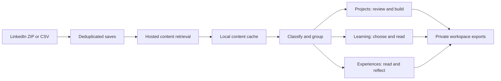

# Saved → Shipped

**Turn your LinkedIn saved archive into readable ideas and projects you can act on.**

[](https://github.com/the-anantkumar/saved-to-shipped/actions/workflows/tests.yml)
[](LICENSE)


Saved → Shipped is an open-source workbench for developers with a collection of good ideas hidden in LinkedIn bookmarks. Import your official archive, retrieve available post content through a hosted extractor, and give each save a home: a project to build, something to learn, or an experience to revisit.

Run it locally. Bring your own extractor API key. Add an optional AI key for more specific project suggestions. Your archive and workspace stay on your computer; selected URLs go to the extractor only when you start retrieval.

> **Development preview:** real archive import, a ten-post live provider dataset, and optional OpenAI classification have been checked. Synthetic tests cover the complete workflow and provider failures. Attachment fidelity, inaccessible posts, billing, and fresh-developer setup still need live validation. See the [live check and its limits](docs/LIVE_CHECK.md). This package has not been published to PyPI.

The separate **hosted beta** adds persistent Google or verified Email/password sign-in and private Firestore storage. See [Firebase setup](docs/FIREBASE_SETUP.md) to run it locally against your own project. The hosted application is not publicly deployed, and its free-tier capacity is still being measured. The one-command Python workflow below remains account-free.

## Start in one command

From a checkout of this version, with **Python 3.10+** installed:

```bash
python3 server.py
```

The browser opens at [http://127.0.0.1:8010/](http://127.0.0.1:8010/). There are no runtime packages to install, frontend build tools, database services, or application accounts to configure.

Use **Appearance** in the sidebar to choose **System theme**, **Light**, or **Dark**. System theme follows your device's appearance. Your choice is remembered in this browser and applies to the board, forms, and editors.

Prefer an installed command? Install into your own environment:

```bash
python3 -m venv .venv
source .venv/bin/activate  # Windows: .venv\Scripts\activate
python -m pip install .
saved-to-shipped
```

`python -m saved_to_shipped` also launches the app. Stop it with `Ctrl+C`.

## Your first useful run

1. **Import archive.** Choose your LinkedIn export ZIP or its Saved Items CSV.
2. **Open Settings.** Paste your Apify API token. An OpenAI key and your build/learning goals are optional. Blank key fields keep existing keys.
3. **Process saves.** Follow the next-step panel on Saves. Start with 10 posts and choose a maximum provider charge. The app submits one hosted run and checks it automatically. First-time key setup returns you directly to retrieval.
4. **Review the recovered content.** Readable posts receive text, a title or excerpt, author, source provenance, and available external links. Missing, gated, deleted, and partial results remain visible.
5. **Organize.** Choose **Organize saves**. Build ideas go to **Projects**, learning and reference material to **Learning**, and experience saves to **Experiences**. Suggestions are editable. Notes and pasted source text have a separate **Notes** editor.
6. **Build or read.** In Projects, review next actions and drag approved tasks through To do, In progress, and Done. In the reading spaces, choose a topic, check the preview and read time, or pin something to **Read next**. Open a save to read, keep a takeaway, and explicitly **Mark read**. **Export** stays in the top bar.

You do not need to manually annotate every link. Manual text and notes remain available for inaccessible posts or extra personal context.

The [sample workspace](http://127.0.0.1:8010/?workspace=demo) works without keys and stays separate from personal data. It contains synthetic examples, not live scraped posts. Hosted retrieval is disabled for demo URLs.

## Three spaces, three intentions

| Space | What belongs here | How you use it |
| --- | --- | --- |
| **Projects** | Saves classified as Build / Project | Review small next actions, drag tiles, plan a week, and attach finished work. |
| **Learning** | Learning and reference saves | Browse editorial rows by topic, search, or available reading time. Keep a short Read next queue. |
| **Experiences** | Stories, interview experiences, event opportunities, and other experience saves | A separate reading library with the same topic and progress controls. |

**Saves** is the intake area for import, retrieval, and classification. It remains available when something needs more context.

The reading spaces offer **To read**, **Reading**, **Read next**, **Read**, and **All** filters. To read includes unfinished reads. In-progress saves appear first, followed by your Read next choices and newer saves. Read-time estimates use the available text at 200 words per minute; missing attachments and shortened content remain labeled. No reading suggestion calls an AI provider.

Opening a readable save starts its reading progress. Scrolling remembers your furthest position, and opening it again resumes near that point. Scrolling never marks a save complete. Use **Mark read** when finished, or **Mark as unread** to reset it. **Organize** changes the title, topic, or kind without a task form; **Your notes** stays separate from the source.

Need another home for a save? Choose **+ New project…**, **+ New learning topic…**, or **+ New experience section…** inside its organizing dropdown. Name it in the same form, then save to create and assign it together. Other unsaved edits stay in place; cancelling creates nothing. Existing names are reused without duplicates.

Reading progress is independent of project stages. Existing task states, notes, text, and group assignments are preserved. Older learning or experience saves marked In progress or Done initially appear as Reading or Read until you set their reading state. Existing groups act as reading topics, so no regrouping or re-import is needed.

## How it works



### Archive input

LinkedIn's Saved Items export contains saved dates and URLs, not other people's post bodies. That is why content retrieval is a separate step. Request an export containing **Saved Items** from **Settings & Privacy → Data Privacy → Download your data**. [LinkedIn's instructions](https://www.linkedin.com/help/linkedin/answer/a1341346).

The importer recognizes nested files, numeric suffixes such as `Saved_Items_123456789.csv`, and both `Date Saved` / `URL` and `savedItem` / `CreatedTime` headers. **Saved Jobs is a different category.** Only Saved Items is read from the ZIP.

Re-importing skips duplicate links and preserves notes, classifications, project assignments, and progress. Uploads are capped at 128 MiB; the uncompressed Saved Items CSV at 8 MiB. Import the CSV directly if the full ZIP is too large.

### Hosted retrieval

The first adapter uses [data_minds/linkedin-post-scraper on Apify](https://apify.com/data_minds/linkedin-post-scraper). The app supplies selected post URLs with extra profile discovery disabled. No LinkedIn password or browser cookie is requested.

- Start with 10 posts, process up to 50, or select all eligible saves up to 1,000 in one run.
- Set a per-run maximum charge. This is sent to Apify using its documented `maxTotalChargeUsd` option. Provider account plans and result limits still apply. [Apify API contract](https://docs.apify.com/api/v2/actors-runs-post).
- Results are matched to requested URLs or post IDs, never assigned by list position.
- Successful content is cached and skipped on later runs. Your notes and edits are preserved.
- Run references persist locally. Closing the tab or restarting the app resumes checking the same hosted run.
- Stop a known run or retry unavailable saves explicitly. If a submission's outcome is uncertain, the app asks you to check the provider console before submitting again.

Only content the provider can retrieve is available. Private, removed, and gated posts may remain unavailable. When supplied, document transcripts are included; image/video content and missing transcripts are labeled partial. Long text is capped at 20,000 characters with a visible truncation notice. External links are listed but are not automatically crawled.

The adapter implements this actor's documented input/output schema. Changing `APIFY_ACTOR` requires a compatible actor; arbitrary Apify actors are not interchangeable. A ten-post live dataset matched this project's saved links; broader coverage and submission reliability remain under validation. See the [live check](docs/LIVE_CHECK.md).

### Classification

| Method | Setup | Result |
| --- | --- | --- |
| Local rules | None | Offline keyword suggestions, broad groups, generic first actions; labeled low confidence. |
| OpenAI | Your API key | Context-specific drafts and project groups. Processes up to 20 saves within a text budget per batch. |
| ChatGPT copy/paste | Your existing ChatGPT access | Download a prompt and paste the resulting triage JSON back into the app. |

The OpenAI dialog can continue through all eligible saves in batches. Closing it stops additional batches after any current request finishes. API usage is billed to your key.

URL-only and title-only saves are excluded. Retrieval coverage accompanies the supplied context. Classification produces editable suggestions. Project tasks remain drafts until reviewed; a ready task requires context, a title, classification, first action, done condition, and a 0.25 to 2 hour first-action estimate. Reading does not require approving a task or setting an effort estimate.

## Configuration

Settings can be entered in the UI. Environment variables override locally saved values:

| Variable | Purpose |
| --- | --- |
| `APIFY_TOKEN` | Hosted extraction credential. |
| `APIFY_ACTOR` | Compatible actor override; default `data_minds/linkedin-post-scraper`. |
| `OPENAI_API_KEY` | Optional AI classification credential. |
| `OPENAI_MODEL` | Optional model override; default `gpt-4.1-mini`. |
| `SAVED_TO_SHIPPED_DATA_DIR` | Optional directory for persistent state and local settings. |

`.env` is not loaded automatically. [.env.example](.env.example) documents shell configuration. You can use Settings instead of exporting variables.

```bash
saved-to-shipped --doctor       # show paths and configured/not-configured status, never keys
saved-to-shipped --port 8011
saved-to-shipped --no-browser
saved-to-shipped --state /path/to/private/items.json
```

In a source checkout, state defaults to `data/items.json`. An installed package uses `$XDG_DATA_HOME/saved-to-shipped/items.json` or `~/.local/share/saved-to-shipped/items.json`. Demo data and private settings are separate files beside the personal store. `--doctor` shows the resolved path.

## Data, privacy, and costs

The application is MIT licensed and has no hosted application subscription. The selected extraction provider and optional AI provider charge under your own accounts.

Saving settings or importing an archive does not start a paid request. Starting retrieval sends selected URLs to Apify. AI classification sends the selected titles, retrieved or supplied text, notes, goals, coverage, and existing project names to OpenAI. The raw ZIP and unrelated account records are excluded.

Keys are held in a separate private local settings file, with owner-only permissions on supported systems. They are not returned in API state responses or included in exports. The OpenAI client uses strict structured outputs and `store: false`; provider data policies still apply.

The server listens on loopback only, validates its Host header, and requires a per-run write token. State updates use atomic file replacement. Stop the web server before mutating the same store through the CLI or restoring a backup.

## Exports

**Export backlog** produces one ZIP with:

- `backlog.json`: workspace backup, including reading progress and Read next choices, excluding provider credentials.
- `backlog.csv`: portable task table with project names, estimates, sources, and results.
- `weekly_sprint.md`: up to two reviewed build tasks fitting your selected hours, with optional learning/experience suggestions listed separately.
- `issues/*.md`: local GitHub issue drafts with source links and acceptance criteria.

Issue drafts are not published automatically. Backups contain your supplied text and notes; keep them private. To restore, stop the server and copy the extracted `backlog.json` to the state path printed by `--doctor`.

## Troubleshooting

| Symptom | Next step |
| --- | --- |
| Saved Items file missing | Check that the export includes Saved Items rather than Saved Jobs. |
| More than one Saved Items CSV | Import the intended CSV directly. |
| Extractor not configured | Add the token in Settings or set `APIFY_TOKEN`. |
| Fewer results than requested | Inspect run counts and the provider's plan/result limits. Retry missing saves explicitly. |
| Submission outcome uncertain | Check Apify Console for an existing run before dismissing the local submission. |
| Existing run needs attention | Use Check results now to retry reading it without starting a new paid run. |
| Partial or unavailable content | Inspect coverage, source link, and external links. Add context or park the save. |
| Nothing ready to classify | Retrieve content first; a URL or title alone is insufficient. |
| Port already in use | Choose another `--port` and use the printed URL. |

## Development and contributions

```bash
python3 -m unittest discover -s tests -v
node --check saved_to_shipped/web/app.js
node --check saved_to_shipped/web/onboarding.js
node --check saved_to_shipped/web/theme.js
node --check saved_to_shipped/web/reading.js
node --test tests/*_behavior.mjs
```

Node is only needed for JavaScript syntax and behavior checks. CI covers Python 3.10, 3.12, and 3.14 on Linux, plus Python 3.12 on macOS and Windows. Installed checks exercise the local organizing, reading, export, and restart flow outside the checkout. A separate job validates wheel/source contents and metadata, then installs each in a fresh environment. Automated provider responses are mocked; tests do not spend API credit.

For release builds, see [docs/RELEASING.md](docs/RELEASING.md). Optional build tools are in `requirements-dev.txt`; the runtime remains dependency-free. The [changelog](CHANGELOG.md) records unreleased work, and [SECURITY.md](SECURITY.md) explains private reporting and the local application boundary.

See [CONTRIBUTING.md](CONTRIBUTING.md) for setup, test fixtures, and release gates; [ARCHITECTURE.md](ARCHITECTURE.md) for implementation boundaries; [PRODUCT_SPEC.md](PRODUCT_SPEC.md) for the user journey; and [ROADMAP.md](ROADMAP.md) for outstanding work.

A separate **closed hosted implementation** now includes Google sessions, isolated workspaces, browser-side imports and durable provider jobs. Its synthetic browser/API flow is tested; it is not deployed or accepting members. The local instructions above remain account-free.

To try the hosted flow without creating cloud accounts or spending provider credit, use Node 24 in a checkout:

```bash
cd hosted
npm ci
npm run uat
```

Open the loopback URL it prints. This disposable preview has visible Alice, Bob and Charlie test-account controls and mocks all providers; use only test content and dummy keys. Its data disappears when stopped. It exercises the same interface and API paths as the hosted build, with a separate test-only identity entrypoint. Use the [UAT checklist](docs/UAT.md) to exercise it.

Hosted batches contain at most 25 retrieval links. Workspaces enforce 1,000 saves, 5 MB logical storage and a 128 KiB per-save limit; actual hosted capacity is still unverified. Hosted exports contain the v1 JSON backup and a CSV, and **Import** can restore the backup. Provider credentials are encrypted on the server and excluded from exports. See the [hosted guide](hosted/README.md), [shipping plan](docs/SHIP_PLAN.md) and [production execution plan](docs/PRODUCTION_PLAN.md) for the remaining live sign-in, capacity and release checks.

Existing CLI commands remain available through `python3 saved_to_shipped.py --help` or the installed `saved-to-shipped-cli` command. Future source adapters can reuse the normalized save contract. Native Reddit and Instagram archive support is outside the current web release.
