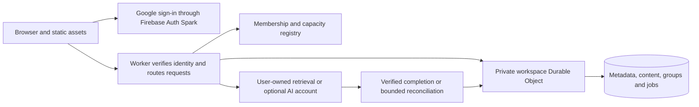

# Free beta execution plan

**Firebase backend update, 2026-11-07:** the requested backend now uses Firebase Authentication (Google and verified Email/password) and Firestore Enterprise Native as the authoritative database, with a trusted Cloudflare API and disposable SQL projection. See [setup and recovery](FIREBASE_SETUP.md) and [phase evidence](evidence/FIREBASE.md). The original SQL-only plan and measurements below are historical design evidence. Firestore Spark has 1 GiB total storage, so the 500-member allocation cannot be carried over; admission stays closed until a revised cohort and actual read/write/storage accounting pass review. Hard-free limits remain mandatory.

Status: P0 complete; P1 has reviewed local experiments and a bounded synthetic probe exercised and retired on Cloudflare Free. P2-P5 private storage, identity, browser integration and durable jobs are implemented and reviewed with synthetic end-to-end checks. P6 local/package checks and the P7 shipping plan are prepared. Physical-storage accounting and production budgets remain unresolved, so the hosted application stays closed and undeployed. Last reviewed: 2026-11-07. See [P0 evidence](evidence/P0.md), [local P1 evidence](evidence/P1.md), [cloud P1 evidence](evidence/P1-CLOUD.md), [P2 evidence](evidence/P2.md), [backend evidence](evidence/P3-P5.md) and [browser evidence](evidence/P4.md).

Build a useful, private hosted workspace for a bounded cohort while retaining the account-free local application. The user has chosen **hard free limits with no overage billing**. A paid plan with alerts does not meet that requirement.

This plan is the implementation source of truth. [ARCHITECTURE.md](../ARCHITECTURE.md) describes the application that exists today; [RELEASING.md](RELEASING.md) covers its local package release. Proposed paths below are deliverables, not existing components or working commands.

## Product and capacity contract

| Setting | Target | Enforcement |
| --- | ---: | --- |
| Admitted members | 500 | Atomic membership reservation; existing members retain access when full |
| Saves per member | 1,000 | Count distinct saves after deduplication |
| Logical workspace bytes per member | 5,000,000 | UTF-8 byte accounting for persisted user data, including notes and organisation metadata |
| Physical workspace database bytes per member | 8,000,000 | Measured database size, including indexes and operational records |
| Combined workspace allocation | 4,000,000,000 | 500 reserved allocations, rather than overcommitting unused storage |
| Platform storage reserve | 1,000,000,000 | Registry, internal metadata, migration headroom and measurement variance |
| Active retrieval jobs per member | 1 | Atomic job admission, idempotent completion and bounded results |

MB and GB mean decimal bytes. Both item and byte limits apply; long posts can exhaust bytes first. Show the usable limit and current usage, and explain when internal storage pressure prevents an operation. Never silently discard notes or shorten source text to make a write fit.

The earlier synthetic local SQLite experiment placed 1,000 saves at approximately 4.1 MB or 6.9 MB with search and indexes, depending on content lengths. Those figures support a prototype target, not a hosted capacity guarantee. Reproduce the experiment from committed synthetic fixtures in P1. Validate multibyte text, long notes, varied search terms, edits, deletions and database growth, not just average fresh imports.

The current documented Durable Objects Free allowances are 5 GB storage, 100,000 requests/day, 5 million rows read/day, 100,000 rows written/day and 13,000 GB-seconds/day. Free-limit exhaustion produces errors, and daily limits reset at midnight UTC. Recheck these values and account-wide usage before each rollout. [Durable Objects pricing](https://developers.cloudflare.com/durable-objects/platform/pricing/)

The ordinary API Worker has separate request and CPU limits. Reserve capacity for authentication, retries, export, deletion, monitoring and any other workloads in the account. An idle reading page must not keep a backend object active. [Workers limits](https://developers.cloudflare.com/workers/platform/limits/)

## Target implementation

Use a TypeScript adapter under `hosted/` for Cloudflare Workers Free and SQLite-backed Durable Objects. Keep its dependencies and build separate from the dependency-free Python package. Reuse the existing browser interface through an explicit transport adapter. Capture Python behaviour in synthetic contract fixtures before porting business rules.



One workspace object belongs to one verified Firebase UID. A small registry coordinates membership and global admissions. Do not route from a client-provided owner, email address, object ID or provider run ID. Keep provider network calls outside storage transactions, and avoid a global registry round trip on every reading request.

Google is the only initial sign-in provider. The browser uses managed Firebase persistence and token renewal; the API verifies the signed ID token with an edge-compatible maintained library, expected issuer/audience, expiry and required claims. Fetch and cache verification keys correctly. Tokens stay out of URLs, logs and workspace exports. Firebase UID is identity; email is display/contact data. If a later change introduces cookies, define CSRF, origin, cookie lifetime and logout semantics before using them. [Firebase token verification](https://firebase.google.com/docs/auth/admin/verify-id-tokens)

The app's membership state handles suspension and deletion immediately. Document the behaviour of already-issued Firebase tokens and test expiry, account deletion and administrative revocation; token signature validation alone is not a revocation check. Firebase stays on Spark, with no SMS or billing-enabled features. Verify actual project configuration during deployment preparation. [Firebase plans](https://firebase.google.com/docs/projects/billing/firebase-pricing-plans)

Persist separate metadata, source content/notes, groups, jobs, usage and encrypted credentials. Keep task status separate from reading state. Preserve source identity, user edits, retrieval coverage and uncertain-submission handling. Credentials never appear in normal snapshots, exports or backups offered to users. Encryption uses a maintained primitive and a deployment secret outside the database, with a versioned rotation procedure.

## Delivery sequence and ownership

The coordinating agent owns integration, shared contracts, phase status and commits. `beta_platform` owns hosted persistence/auth/jobs, `beta_product` owns browser integration, `beta_reviewer` independently checks correctness and boundaries, and `beta_release` owns release evidence and operations. Assign file ownership before concurrent edits; the coordinator serializes shared schema and API changes.

Release gate order: **P0 -> P1 -> P2 -> P3 -> P4 -> P5 -> P6 -> P7**. On 2026-11-07 the user requested finishing development and end-to-end validation before planning shipment. Closed implementation of P2-P5 therefore proceeds against the provisional no-FTS storage design while P1 measurements remain open. This changes implementation scheduling, not admission or capacity requirements: the default cohort stays zero, and no production physical-storage guarantee is claimed. P4 UI work can start against approved P2 contracts while P3 is implemented. P5 provider fixtures and P6 runbook drafts can proceed in parallel after P2. No downstream implementation may quietly redefine a shared contract.

| Phase | Status | Primary owner | Dependency | Reviewable result |
| --- | --- | --- | --- | --- |
| P0 | Complete | Coordinator | Existing release foundation | Plan, repository instructions, configured agents and skills; [evidence](evidence/P0.md) |
| P1 | Local and small cloud checks; physical accounting and metering gates open | beta_platform | P0 | Reproducible runtime and storage evidence; [local](evidence/P1.md) and [cloud findings](evidence/P1-CLOUD.md) |
| P2 | Implemented and reviewed locally; physical gate depends on P1 | beta_platform | P1 provisional no-FTS contract | Hosted contracts, private storage and quota enforcement; [evidence](evidence/P2.md) |
| P3 | Implemented and reviewed synthetically; real Google canary pending | beta_platform | P2 | Google sessions, membership and account lifecycle; [evidence](evidence/P3-P5.md) |
| P4 | Eight synthetic browser flows passed; real login pending | beta_product | P2 contracts; P3 for integration | Import, organisation, reading and deletion recovery; [evidence](evidence/P4.md) |
| P5 | Implemented and reviewed with mocked providers; live check pending | beta_platform | P2-P4 | Durable retrieval and optional classification; [evidence](evidence/P3-P5.md) |
| P6 | Local isolation, package and final-schema capacity checks passed; cloud gates open | beta_reviewer + beta_release | P3-P5 | [Verification](evidence/P6.md), [capacity](evidence/P6-LOCAL-CAPACITY.md) and [operations](HOSTED_OPERATIONS.md) |
| P7 | Shipping plan prepared; nothing published or deployed | beta_release | P6 | [Shipping plan](SHIP_PLAN.md) for separate local and hosted releases |

### P0: Establish the execution contract

- Deliver this plan, root `AGENTS.md`, project agents and narrow project skills. Link them from contributor guidance and the roadmap.
- Keep assumptions, measured findings and unimplemented work visibly distinct. Record useful commands only when the corresponding tooling exists.
- Exit: configuration parses; skill references resolve; independent review confirms that a future agent can identify the next phase and required evidence.
- Commit: `docs: define the free beta execution plan` followed by `chore: configure production agents and skills`.
- Rollback: revert the documentation/configuration commit; runtime and personal data are unaffected.

### P1: Prove the runtime and capacity model

- Owner: `beta_platform`; reviewer: `beta_reviewer`.
- Proposed files: `hosted/package.json`, lockfile, `hosted/wrangler.jsonc`, minimal Worker/object entrypoints, `hosted/tests/capacity/`, `docs/evidence/P1.md`.
- Pin tooling and generate a minimal local Worker plus SQLite object. Verify hosting-plan compatibility, static asset routing, token verification CPU, SQL/FTS support, database-size measurement and transaction behaviour.
- Generate synthetic 500/1,000-item libraries, richer notes and multibyte text. Measure logical bytes, physical bytes, search-index growth, rows read/written, response CPU and active object duration. Include repeated edits/deletes and schema migration overhead.
- Prove whether physical growth can be checked and rolled back atomically. A rollback may leave allocated pages or metering effects; do not equate logical rollback with zero physical growth or zero resource consumption. Use preflight bounds and an explicit safety margin where necessary.
- Compare local runtime measurements with a bounded synthetic remote probe when deployment is authorised. Do not load-test the entire account until it hits a provider hard limit.
- Exit: reproducible evidence supports the per-user budgets and a concrete request/ingestion budget; unsupported assumptions have a resolved alternative. If 500 seats do not fit, reduce admission rather than enable billing.
- Commit: `feat: validate the free beta runtime and capacity budgets`.
- Rollback: disable the prototype route and remove only disposable synthetic resources; retain evidence. No personal-data migration occurs in this phase.

Cloudflare exposes database size and transactional storage APIs, but P1 must verify their behaviour for our schema and write pattern. [SQLite storage API](https://developers.cloudflare.com/durable-objects/api/sqlite-storage-api/)

The P1 experiment found that `sql.databaseSize` excludes allocated free pages. A successful used-page quota check therefore does not prove the 8 MB physical allocation budget. It also found that full-text indexes with varied vocabulary leave too little edit headroom, and local FTS row counters cannot certify account metering. Keep the physical-budget gate open; use the [P1 evidence](evidence/P1.md) for the provisional no-FTS search design, maintenance margin and bounded ingestion proposal. These constraints must be verified against the final schema and cloud meter before the storage contract is approved for production admission.

Cloudflare deployment access and the Free plan are verified. The independently reviewed 50-save probe passed its fixed import/read/edit/rollback/delete/search steps and 16 synthetic token checks. Its 493 reported row writes reconcile with instrumentation, including control work and rejected writes. The FTS step also exposed post-transaction size growth not reflected in its in-transaction check. SQL-storage metrics and ordinary Worker CPU attribution remain inconclusive; no production admission budget is certified. See [cloud probe evidence](evidence/P1-CLOUD.md). The disposable probe was retired after measurement; the application entrypoint stays closed.

### P2: Implement contracts and user-owned storage

- Owner: `beta_platform`; reviewer: `beta_reviewer`.
- Proposed files: `hosted/src/contracts/`, `hosted/src/storage/`, `hosted/src/quotas/`, `hosted/migrations/`, `tests/contracts/`, `hosted/tests/storage/`.
- Define a versioned API contract for metadata pages, item bodies, mutations, groups, usage, imports, jobs and export. List responses contain bounded previews; opening a save loads its body. Use cursors, explicit sort order and validated filters.
- Scope source uniqueness to a user. Existing 12-hex item IDs must never become globally trusted identifiers. Use per-item revisions and transactional group creation/assignment; preserve reading progress until an explicit reset.
- Canonically define logical bytes, including UTF-8 encoding, metadata and notes. Store versioned byte accounting alongside item counts. Enforce item, logical and physical limits before returning success; concurrent updates must not bypass accounting.
- Quota checks cover imports, retrieval application, classification, restored backups, notes, groups and administrative tools. Reserve write capacity before expensive work. A rejected write preserves the previous workspace and returns an actionable code.
- Build global admission/batch budgets with conservative reservations and reconciliation. Charge internal bookkeeping, indexes, failed attempts and retries to the resource model. Bound job history and other operational records.
- Keep backend implementation free of public request routes until P3 provides authentication and ownership. Build synthetic two-user tests through the internal contract.
- Exit: parity fixtures cover deduplication, grouping, edits, reading/task independence, export and conflicts; limits hold under simultaneous requests, long Unicode notes, repeat imports and failed commits.
- Commit: `feat: add private workspaces and bounded storage contracts`.
- Rollback: additive schema changes and versioned readers first; retain an export/restore path. Never point the old file server at the hosted database.

### P3: Add Google sign-in and bounded membership

- Owner: `beta_platform`; `beta_product` owns login surfaces after API agreement; reviewer: `beta_reviewer`.
- Proposed files: `hosted/src/auth/`, `hosted/src/membership/`, `hosted/tests/auth/`, `hosted/tests/membership/`, browser auth adapter.
- Implement login persistence, renewal, sign-out and explicit account-switch cache clearing. Reject missing, expired, forged, wrong-project and wrong-provider tokens. Use maintained verification code rather than custom JWT cryptography.
- Registry states include reserved, active, deleting and suspended. Atomically claim one seat per UID with a stable operation ID, then provision idempotently. Count reservations toward the cap. Reconcile abandoned reservations without deleting a successfully provisioned member.
- At capacity, return a full-beta state without creating a workspace. Existing members can return normally. A waitlist is optional and independently bounded; it must not allocate workspaces or send messages automatically.
- Every data, export, credential, job and administrative route checks identity and membership. Cross-user object references return the same not-found response as absent resources. Administrative privileges come from a server-controlled stable-UID allowlist.
- Account deletion first blocks mutations and new jobs, reconciles/cancels known external work, removes credentials and workspace data, then releases the seat. Define identity-account deletion/re-entry behaviour. Retries must not free a seat twice or permit old callbacks to recreate a workspace.
- Exit: simultaneous sign-ups for the last seat admit exactly one new member; retry/provisioning-failure tests recover cleanly; member A cannot read or mutate B through any endpoint; sign-out/account-switch does not show cached private data.
- Commit: `feat: add Google authentication and capped beta membership`.
- Rollback: close admission and disable affected routes; existing data remains private. Revert code only to a version compatible with the stored membership state.

### P4: Integrate the product and archive workflow

- Owner: `beta_product`; platform changes go through `beta_platform`; reviewer: `beta_reviewer`.
- Proposed files: browser transport/auth modules, existing `saved_to_shipped/web/` surfaces as needed, `hosted/src/imports/`, browser fixtures and hosted integration tests.
- Preserve Saves, Projects, Learning and Experiences, dark mode, independent notes and reading state, inline group creation and accessible board movement. Hosted transport replaces whole-workspace refreshes with explicit requests and bounded optimistic updates.
- Extract only the relevant Saved Items CSV in the browser, with compressed/uncompressed-size limits and resource bounds. Send validated chunks with import ID, ordering/checkpoint and deduplication. Validate again on the server; client checks are not authority.
- Plan imports against remaining count/bytes and explain partial capacity before starting. Chunk commits preserve prior work; retrying a chunk does not duplicate saves or erase annotations. Do not retain original ZIPs, media or unrelated archive records.
- Add full-beta, sign-in expired, quota reached, temporarily paused processing, conflict and provider-unavailable states. Distinguish local and hosted storage/privacy wording.
- Coalesce reading updates and flush safely on navigation; avoid write-on-every-scroll. Load source content on demand and keep exports separate from routine list reads.
- Exit: a new member can import, organise, move a tile, read, annotate, export, sign out and resume on another browser; keyboard/mobile/dark-mode checks pass; the local installed flow remains usable without an account.
- Commit: `feat: connect the workbench to private hosted workspaces`.
- Rollback: restore the previous compatible UI asset version; keep the API contract backward compatible for already-open tabs.

### P5: Make external processing durable and bounded

- Owner: `beta_platform`; `beta_product` owns job/status UI; reviewer: `beta_reviewer`.
- Proposed files: `hosted/src/providers/`, `hosted/src/jobs/`, `hosted/src/credentials/`, provider contract fixtures and job integration tests.
- Store per-user encrypted provider keys, keep encryption material in deployment secrets, and verify redaction, export exclusion and rotation. Reject accidental use of an operator-wide paid provider key for ordinary members.
- Persist submission intent before one bounded external request. Preserve STARTING/UNCERTAIN semantics: losing a response must not trigger another paid submission. Known run IDs can be reconciled; submission retries require an explicit user decision where outcome is unknown.
- Apply results in bounded, idempotent pages with source matching, coverage and edit preservation. Reserve storage before retrieval and handle results that exceed remaining capacity without silently deleting context or starting another run.
- Use authenticated callbacks or bounded scheduled reconciliation. Validate ownership and provider state; retries, duplicate callbacks and alarms are expected. Deletion/suspension must win over late callbacks. Never keep an object active for the full external run.
- Enforce per-user concurrency and global ingestion reservations. Admit jobs only when completion work has budget; defer new work first and retain headroom to finish accepted jobs. Publish progress from small job records rather than full-library refreshes.
- Port optional classification through the same credential, quota and job boundaries. Preserve local rules and context requirements. User content is untrusted input, and classifier output is validated data rather than executable instructions.
- Exit: mocked failure/timeout/retry/callback tests prove no duplicate submission or cross-user results. A separately authorised, small live check records fidelity and actual provider charge; free hosting does not mean free extraction or AI.
- Commit: `feat: add durable retrieval and classification jobs`.
- Rollback: stop new submissions, retain known run references and reconcile accepted work. Reverting application code cannot undo external provider charges.

### P6: Validate capacity, isolation and recovery

- Owner: `beta_reviewer` for independent findings; `beta_release` for operational evidence; implementers fix findings in their owned files.
- Proposed files: `hosted/tests/load/`, `hosted/tests/isolation/`, `docs/HOSTED_OPERATIONS.md`, `docs/evidence/P6.md`, hosted CI workflow.
- Model 500 retained workspaces separately from active users. Test ordinary reads/edits, synchronized imports, long reading sessions, callback storms, duplicate requests and maliciously oversized input. Measure all relevant account quotas, including front-door authentication rejections.
- Keep requests short; no normal browsing session or repeating timer may prevent object hibernation. Verify this with runtime metrics, not only wall-clock unit tests.
- Add aggregate, redacted monitoring for physical storage, admissions, reads/writes, request counts, active duration, pending jobs and errors. The capacity dashboard must not expose user content or secrets. Bound telemetry retention and its own resource use.
- Implement an operator admission switch and processing circuit breakers before provider hard limits. Select thresholds from P1 evidence and reserve headroom for exports/deletions/retries. A true provider-wide exhaustion can still interrupt service; never promise export/delete availability after every platform quota has already been exhausted.
- Exercise export, deletion, recovery and compatible-code rollback near application limits. Verify backup/restore availability on the actual Free plan. Do not claim backup success from a local SQLite test or restoration without checking credentials and membership consistency.
- CI checks local Python behaviour, frontend behaviour, hosted types/tests/contracts, isolation and deployment manifests. No CI test uses real provider keys or spends provider credit. Secret/history review remains separate from archive-path checks.
- Exit: critical isolation/data-loss issues are resolved; capacity evidence supports the next cohort; restore and rollback are demonstrated with synthetic data; release documentation states measured limits and remaining provider uncertainties.
- Commit: `test: verify beta isolation capacity and recovery`.
- Rollback: close admission and processing, preserve diagnostics and data, restore the last compatible build. Data restoration is a separately scoped operation with a specific recovery point.

### P7: Publish and admit the cohort

- Owner: `beta_release`; final integration/release decision: coordinator and user.
- Proposed files: release/publish workflows, static synthetic demo, hosted deployment workflow, updated README/security/privacy/operations documentation, `docs/evidence/RELEASE.md`.
- Finish the local release gates in [RELEASING.md](RELEASING.md), including a fresh-developer trial and reviewed artifacts. Configure package ownership and short-lived publishing credentials. Repository visibility, package publication and hosted deployment are separate concrete release actions.
- Build a browser-only synthetic demo; the existing server-backed demo is not a static deployment. The public page offers hosted access, a truthful beta-full state and a working local install route.
- Prepare reviewed configuration showing Cloudflare Free and Firebase Spark, exact domains/origins, bindings, secret names, cohort cap and rollback version. Keep secret values out of source control; public deployment identifiers may be versioned. Use a provider subdomain initially if a new paid domain would violate the budget.
- Deploy a closed synthetic preview when authorised. Verify Google login, ownership, storage accounting, external-job reconciliation and account deletion against the deployed build before admitting real members.
- Release seats in stages: **10 -> 50 -> 100 -> 250 -> 500**. At each stage, observe at least one complete UTC quota window and a representative import/retrieval cycle; hold or reduce new admission when measurements do not support growth. This is a gate, not an automatic daily ramp.
- Exit: the release record identifies exact artifacts, commits, environments, tested cohort, observed quota consumption and recovery evidence. Only the verified cohort is advertised; reaching 500 is contingent on evidence.
- Commit: `release: prepare the capped open source beta`.
- Rollback: close new admission, pause new processing and restore the compatible deployment. Keep already-admitted members and their data unless an explicitly scoped recovery action requires otherwise.

## API and failure contract to freeze in P2

| Condition | Response contract |
| --- | --- |
| Missing/invalid/expired identity | `401`, no private response body; client may renew once before prompting |
| Valid identity, no admitted membership | `403` with `BETA_FULL` or `MEMBERSHIP_REQUIRED`; no workspace provisioning |
| Absent item or another user's item | Same `404` shape to avoid disclosing ownership |
| Revision mismatch or incompatible transition | `409`, reload relevant record and preserve unsaved user edits |
| Oversized request | `413`, reject before parsing/expensive processing |
| Item/logical/physical quota reached | `409` with specific `QUOTA_EXCEEDED` reason and available corrective actions |
| Application daily budget/rate limit | `429` with bounded retry guidance; no automatic paid resubmission |
| Provider/platform temporarily unavailable | `503` with safe recovery state; retain known jobs and existing content |

Do not redirect APIs to HTML login pages. No endpoint trusts a client-supplied UID or accepts a workspace selector equivalent to today's global `personal`/`demo` routing. Use strict origin/CORS handling and test hostile origins alongside normal login flows.

## Inputs needed before external rollout

Local experiments and contract fixtures do not need these inputs. P1's remote accounting/performance gates and later live integration do; use [account preparation](HOSTED_SETUP.md) when they are available:

- A Cloudflare account confirmed on Free, with measured allowance available and narrowly scoped deployment access.
- A Firebase project confirmed on Spark, Google sign-in configuration, authorised origins and public web configuration. No Gmail mailbox scopes are needed.
- Server-only encryption and callback-verification secrets, supplied through the platform secret mechanism.
- Explicit operator identities and a recovery contact/process; ownership of the eventual repository/package release destinations.
- Authorised synthetic preview deployment, and separately bounded live provider checks when needed. Existing user authorisation persists; do not request it again for the same action and scope.

Do not paste secrets into chat, agent handoffs, committed examples or evidence. Preparing code, manifests, tests and a reviewable release candidate does not require enabling billing or publishing anything.

## Evidence and handoff format

Each phase record must include:

```text
Phase / status:
Commit and artifact identifiers:
Owner / independent reviewer:
Contract or schema changes:
Commands and environment actually used:
Observed results and failures:
Quota measurements and sample size:
Unverified assumptions / blocked external inputs:
Rollback and recovery evidence:
Next phase and allowed parallel work:
```

Record results only after executing checks. Keep synthetic fixtures and reproduction commands in the repository; personal content and credentials stay in private local evidence. A phase is complete when its acceptance checks pass, not when its files exist.
